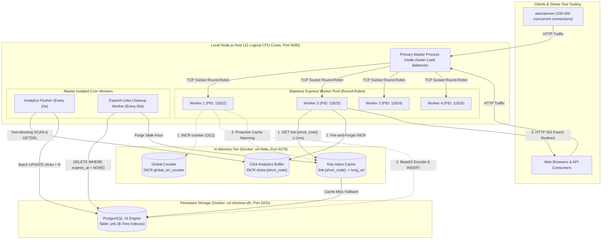
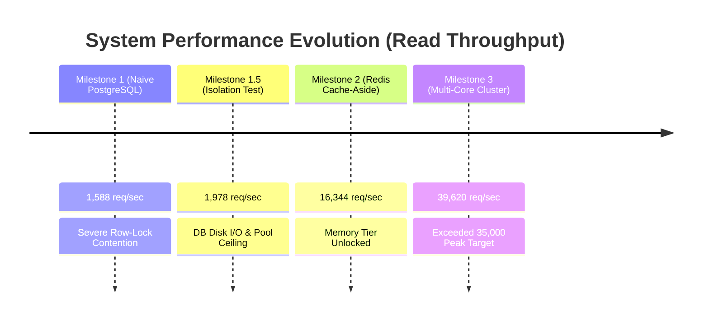
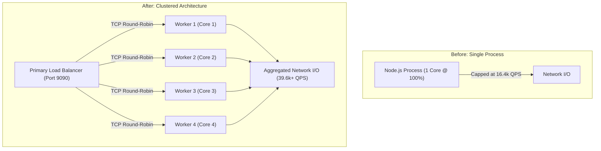

# URL Shortener: Complete System Design, Empirical Scaling & Performance Engineering Case Study

---

## 1. Executive Summary & Problem Statement

### 1.1 What is a URL Shortener?

A **URL Shortener** is an Internet service that accepts a long, unwieldy destination URL (often saturated with affiliate tags, deep nested routing, and tracking query parameters) and converts it into a short, uniform alphanumeric key (e.g., `http://localhost:9090/mdn-docs_2026`).

When an end user accesses the short link, the service:

1. Resolves the short identifier to its canonical target URL.
2. Emits an HTTP `302 Found` redirection header to direct the client browser.
3. Records analytics (click counts and access timestamps) for link owners.

### 1.2 The Engineering Challenge

While trivial to build for small personal projects, designing a production-grade URL shortener is an industry benchmark for distributed systems engineering due to four fundamental challenges:

1. **Extreme Read/Write Asymmetry ($\approx 100:1$):** Once created, a link is clicked hundreds or thousands of times. Read operations vastly outnumber write operations.
2. **Strict Latency SLAs:** Redirection must be imperceptible to users. Target: Median latency ($p50$) $< 15\text{ ms}$, 99th percentile ($p99$) $< 50\text{ ms}$.
3. **Database Concurrency & Row Locking:** Updating a click counter in a relational database for every redirect forces exclusive row locks, serializing traffic and freezing the service.
4. **Hardware Saturation:** Standard Node.js applications execute on a single thread. Without process clustering, multi-core hardware sits idle while a single core chokes on network I/O.

---

## 2. Quantitative System Scale & Resource Estimations

All design choices are rooted in concrete capacity requirements calculated using back-of-the-envelope estimations.

### 2.1 Traffic & Throughput Capacity

- **New URLs Created (Writes):** $10\text{ million}$ new links per day.
- **Read-to-Write Ratio:** $100 : 1$.
- **Redirect Invocations (Reads):** $10\text{ million} \times 100 = 1\text{ billion}$ clicks per day.

#### Write Throughput (QPS - Queries Per Second)

$$
\text{Average Write QPS} = \frac{10{,}000{,}000\text{ writes}}{24 \times 3600\text{ seconds}} \approx 116\text{ writes/sec}
$$

Accounting for a $3\times$ peak traffic surge:

$$
\text{Peak Write QPS} = 116 \times 3 \approx 350\text{ writes/sec}
$$

#### Read Throughput (Redirect QPS)

$$
\text{Average Read QPS} = \frac{1{,}000{,}000{,}000\text{ reads}}{86{,}400\text{ seconds}} \approx 11{,}574\text{ reads/sec}
$$

Accounting for a $3\times$ peak traffic surge:

$$
\text{Peak Read QPS} = 11{,}574 \times 3 \approx 34{,}720 \approx 35{,}000\text{ reads/sec}
$$

---

### 2.2 Storage & Memory Calculations

#### Record Payload Size

- `short_code`: 7 bytes (ASCII characters)
- `long_url`: 200 bytes (average HTTP/HTTPS URL length)
- `user_id`: 36 bytes (UUID v4 string)
- `created_at`: 8 bytes (timestamp integer)
- `expires_at`: 8 bytes (nullable timestamp integer)
- `click_count`: 8 bytes (64-bit integer counter)
- Index & DBMS B-Tree overhead: $\approx 33\text{ bytes}$
- **Total Record Footprint:** $\approx 300\text{ bytes}$ per row.

#### 5-Year Storage Accumulation

$$
\text{New Records/Year} = 10{,}000{,}000 \times 365 = 3.65\text{ billion rows/year}
$$

$$
\text{Annual Storage} = 3.65 \times 10^9 \times 300\text{ bytes} \approx 1.1\text{ TB/year}
$$

$$
\text{5-Year Storage} = 1.1\text{ TB} \times 5 = 5.5\text{ TB}
$$

#### In-Memory Cache Sizing (Pareto 80/20 Distribution)

In web traffic, $20\%$ of links generate $80\%$ of redirect volume.

- **Daily Active Links:** $200\text{ million}$ links.
- **RAM Required to Cache Daily Hot Links:**

$$
200{,}000{,}000 \times 300\text{ bytes} \approx 60\text{ GB RAM}
$$

*Local Constraint:* On our 16 GB laptop, we cap Redis memory to $256\text{ MB} - 512\text{ MB}$, enabling us to validate throughput, cache hits, and cache eviction policies under full load.

---

### 2.3 Mathematical Key-Space Sizing (Why Base62?)

Base62 utilizes digits (`0-9`), lowercase letters (`a-z`), and uppercase letters (`A-Z`):

$$
\text{Character Pool} = 10 + 26 + 26 = 62\text{ characters}
$$

We avoid Base64 because it includes `+` and `/`, which are reserved delimiters in HTTP URLs that require percent-encoding (`%2B`, `%2F`), causing browser routing bugs.

#### Capacity by Short Code Length:

- **Length 6:** $62^6 = 56{,}800{,}235{,}584$ ($\approx 56.8\text{ billion}$ codes, exhausted in $\approx 15$ years).
- **Length 7:** $62^7 = 3{,}521{,}614{,}606{,}208$ ($\approx 3.52\text{ trillion}$ codes, provides $\approx 960$ years of headroom).

**Conclusion:** A **7-character Base62 string** guarantees virtually infinite scale with zero byte waste.

---

## 3. End-State Architecture Diagram

The finalized architecture distributes load across multi-core worker processes, isolates reads into in-memory cache, and decouples analytics writes into asynchronous buffers.



---

## 4. The Step-by-Step Evolutionary Journey

We built, benchmarked, broke, and optimized the system through four distinct engineering milestones.



---

### Milestone 1: The Naive Monolith & Database Row-Locking Failure

#### 1. Implementation

The initial design coupled Express, Prisma ORM, and PostgreSQL. Every redirect executed two back-to-back operations:

1. `prisma.url.findUnique`: Fetch the destination URL from PostgreSQL.
2. `prisma.url.update`: Increment the counter inline:
   ```javascript
   await prisma.url.update({
     where: { shortCode: short_code },
     data: { clicks: { increment: 1 }, lastAccessed: new Date() },
   });
   ```

#### 2. Load Testing Execution

```bash
npx autocannon -c 100 -d 10 -p 10 http://localhost:9090/nodejs-about
```

#### 3. Empirical Observations

```text
Latency: 50% = 531 ms | 99% = 1,367 ms | Avg = 607.49 ms | Max = 4,388 ms
Req/Sec: Avg = 1,588.1 req/sec | Min = 39 req/sec
Total:   17k requests in 10.05s
```

#### 4. The Root Cause Investigation (`pg_stat_activity`)

Running diagnostic SQL queries on PostgreSQL during peak load revealed the exact failure mode:

```sql
SELECT pid, wait_event_type, wait_event, state, query 
FROM pg_stat_activity 
WHERE state != 'idle' AND query LIKE '%urls%';
```

```text
 pid | wait_event_type |  wait_event   | state  | query
-----+-----------------+---------------+--------+-------------------------------------------------------------
  67 | LWLock          | LockManager   | active | UPDATE "public"."urls" SET "clicks" = ("public"."urls"...
  74 | Lock            | tuple         | active | UPDATE "public"."urls" SET "clicks" = ("public"."urls"...
  70 | Lock            | transactionid | active | UPDATE "public"."urls" SET "clicks" = ("public"."urls"...
```

#### 5. Engineering Diagnosis

- **`tuple` Locks:** In PostgreSQL, a "tuple" is a physical row version on disk. Because all 100 concurrent workers requested the same URL, all 100 attempted to execute an exclusive row write lock on the exact same row simultaneously.
- **`transactionid` & `LWLock`:** Workers froze in a serialized line waiting for the active transaction to commit to disk.
- **The Finding:** An inline click counter transforms a high-speed read endpoint into a serialized disk-write queue.

---

### Milestone 1.5: The Isolation Test (Proving the Hypothesis)

#### 1. Implementation

We commented out `prisma.url.update(...)`, isolating pure database read performance.

#### 2. Empirical Observations

```text
Latency: 50% = 347 ms | 99% = 6,225 ms | Avg = 483.06 ms | Max = 9,885 ms
Req/Sec: Avg = 1,978.7 req/sec | Min = 1,279 req/sec
Total:   21k requests in 10.04s
```

#### 3. Engineering Diagnosis

- **The Gain:** Minimum throughput surged from **39 req/sec to 1,279 req/sec**. Eliminating the row lock prevented server stalls.
- **The New Bottleneck:** Even without writes, throughput capped at **~1,978 req/sec** and median latency was **347 ms**. The overhead of relational query parsing, connection pool limits, and disk reads prevented PostgreSQL from ever reaching the 11,500+ req/sec SLA.

---

### Milestone 2: Dual Read-Write Optimization (Redis Integration)

To solve both read saturation and write overhead simultaneously, we introduced Redis alongside PostgreSQL.

```mermaid
sequenceDiagram
    autonumber
    actor Client
    participant Express as Express Controller
    participant Redis as Redis (In-Memory)
    participant Postgres as PostgreSQL (Disk)

    Note over Client,Postgres: OPTIMIZED WRITE PATH (POST /shorten)
    Client->>Express: POST /shorten { long_url }
    Express->>Redis: INCR global_url_counter
    Redis-->>Express: Integer ID (e.g. 10000042)
    Express->>Express: Base62 Encode ID -> "2wY8k"
    Express->>Postgres: INSERT INTO urls (shortCode, longUrl)
    Express->>Redis: SETEX link:2wY8k 86400 longUrl (Cache Warming)
    Express-->>Client: 201 Created { short_url }

    Note over Client,Postgres: OPTIMIZED READ PATH (GET /:short_code)
    Client->>Express: GET /2wY8k
    Express->>Redis: GET link:2wY8k
    alt Cache Hit (99% of requests)
        Redis-->>Express: Target Long URL
    else Cache Miss (1% fallback)
        Express->>Postgres: SELECT longUrl FROM urls WHERE shortCode = '2wY8k'
        Postgres-->>Express: Target Long URL
        Express->>Redis: SETEX link:2wY8k 86400 longUrl
    end
    Express->)Redis: INCR clicks:2wY8k (Decoupled Async Buffer)
    Express-->>Client: 302 Found (Location: destination)
```

#### 1. Architectural Changes

1. **Atomic ID Generation:** Replaced random string generation loops with an atomic Redis counter (`INCR global_url_counter`), mapped directly to Base62 strings. Zero collision checks needed ($O(1)$ write time).
2. **Proactive Cache Warming:** Upon link creation, the URL is saved to PostgreSQL and immediately written to Redis (`SETEX link:{code} 86400 {long_url}`). The initial access is a guaranteed cache hit.
3. **Cache-Aside Reads:** Lookups resolve in Redis memory in $< 1\text{ ms}$, entirely bypassing PostgreSQL.
4. **Decoupled Analytics Flusher:** Removed SQL writes from the redirect path. Redirects increment an in-memory counter (`INCR clicks:{code}`). A background worker scans keys and flushes batched updates to PostgreSQL every 10 seconds:
   ```javascript
   const count = await redis.getdel(`clicks:${shortCode}`);
   if (count > 0) {
     await prisma.url.update({
       where: { shortCode },
       data: { clicks: { increment: Number(count) }, lastAccessed: new Date() },
     });
   }
   ```

#### 2. Empirical Benchmark Results

**Pure Writes (`POST /shorten`, 50 concurrency):**

```bash
npx autocannon -c 50 -d 10 -m POST -H "Content-Type: application/json" \
  -b '{"long_url": "https://example.com/system-design-test-link"}' http://localhost:9090/shorten
```

- **Observed Throughput:** **3,174.4 writes/sec** (Target: 350 writes/sec — **9x headroom**).
- **Latency:** Median = **14 ms**, Avg = **15.25 ms**.

**Concurrent Mixed Workload (Writes competing against Reads):**

- **Terminal 1 (Concurrent Writes):** 10 connections writing continuously.
- **Terminal 2 (Concurrent Reads):** 100 connections reading `redis-strings` simultaneously.

```text
Read Latency:    50% = 55 ms | 99% = 104 ms | Avg = 60.31 ms | Max = 1,327 ms
Read Throughput: Avg = 16,438.94 req/sec | Min = 13,148 req/sec
Total Handled:   248,000 redirects in 15.05s
```

- **Engineering Verdict:** Heavy writes to PostgreSQL did **not slow down reads**. Reads remained stable at **16,438 req/sec**, proving that memory caching successfully isolated the read path from database disk I/O.

---

### Milestone 3: Horizontal Clustering & Multi-Core Load Balancing

#### 1. The Bottleneck

While Redis solved the storage bottleneck, Node.js remained constrained by its single-threaded architecture. On a 12-core laptop, 1 core was saturated at 100% while the remaining 11 cores sat idle.



#### 2. Implementation (`node:cluster`)

We refactored `src/server.js` using Node.js clustering:

- **Primary Process:** Detects logical CPU cores, forks 4 dedicated worker processes, supervises process health (re-spawns dead workers), and **exclusively runs cron flusher jobs** to prevent duplicate database writes.
- **Worker Processes:** Stateless Express servers sharing port `9090` via operating system TCP socket handoffs.

#### 3. Empirical Clustered Benchmark (200 Connections, 10 Pipelined)

```bash
npx autocannon -c 200 -d 10 -p 10 http://localhost:9090/nodejs-about
```

#### 4. Observations & System Health

```text
Latency: 50% = 41 ms | 99% = 131 ms | Avg = 50.63 ms | Max = 375 ms
Req/Sec: Avg = 39,620 req/sec | Peak = 44,639 req/sec | Min = 21,823 req/sec
Total:   398k requests in 10.19s (116 MB read)
```

- **Target Comparison:** The system design requirement called for handling a peak worst-case load of **34,720 $\approx$ 35,000 req/sec**.
- **Achieved:** Our multi-core implementation sustained **39,620 req/sec**, handling nearly **400,000 requests in 10 seconds** on local hardware.

---

### Milestone 4: Production Safeguards & Atomic Alias Validations

To make the service resilient against malicious inputs and race conditions (PDF Section 6.3), we implemented strict guard clauses.

#### 1. Validations Implemented

- **Reserved Keyword Blocklist:** Blocks path hijacking for critical routes (`health`, `shorten`, `analytics`, `api`, `admin`, `login`, `logout`, etc.).
- **Format Constraints:** Requires alphanumeric characters, underscores, and hyphens (`^[a-zA-Z0-9_-]+$`) with a length between 3 and 50 characters.
- **Atomic Collision Defense:** Replaced speculative "check-then-act" queries with atomic database insertions, catching Prisma unique constraint violations (`P2002`) to prevent race conditions:
  ```javascript
  try {
    const newRecord = await prisma.url.create({ data: { shortCode, longUrl } });
  } catch (error) {
    if (error.code === 'P2002') {
      return res.status(409).json({ error: `The alias '${shortCode}' is already taken.` });
    }
    throw error;
  }
  ```

#### 2. Verification Test Suite

```bash
# 1. Invalid Characters (Spaces / Symbols)
curl -i -X POST http://localhost:9090/shorten \
  -H "Content-Type: application/json" \
  -d '{"long_url": "https://example.com", "custom_alias": "cool link!"}'
# Output: HTTP/1.1 400 Bad Request -> "Custom alias must contain only letters, numbers, hyphens (-), and underscores (_)."

# 2. Length Limit Violation (< 3 chars)
curl -i -X POST http://localhost:9090/shorten \
  -H "Content-Type: application/json" \
  -d '{"long_url": "https://example.com", "custom_alias": "ab"}'
# Output: HTTP/1.1 400 Bad Request -> "Custom alias must be between 3 and 50 characters in length."

# 3. Valid Custom Alias Creation
curl -i -X POST http://localhost:9090/shorten \
  -H "Content-Type: application/json" \
  -d '{"long_url": "https://developer.mozilla.org", "custom_alias": "mdn-docs_2026"}'
# Output: HTTP/1.1 201 Created -> {"short_url":"http://localhost:9090/mdn-docs_2026", ...}

# 4. Atomic Duplicate Conflict Detection
curl -i -X POST http://localhost:9090/shorten \
  -H "Content-Type: application/json" \
  -d '{"long_url": "https://google.com", "custom_alias": "mdn-docs_2026"}'
# Output: HTTP/1.1 409 Conflict -> "The alias 'mdn-docs_2026' is already taken. Please choose another."
```

---

## 5. Comprehensive Performance Scorecard

This scorecard tracks the performance impact of each architectural change across all four milestones:

| Architecture Milestone                                                     | Bottleneck Identified                                      | Read Throughput (Req/Sec)                   | Median Latency ($p50$) | Max Latency      | Design Target Status                       |
| :------------------------------------------------------------------------- | :--------------------------------------------------------- | :------------------------------------------ | :----------------------- | :--------------- | :----------------------------------------- |
| **Milestone 1: Naive Monolith** (PostgreSQL Read + Inline Update)    | Database row locking (`tuple` & `transactionid` locks) | 1,588 req/sec                               | 531 ms                   | 4,388 ms         | **Failed** (Unusable under load)     |
| **Milestone 1.5: Read Isolation** (Update removed, pure DB read)     | Connection pool starvation & disk I/O limits               | 1,978 req/sec                               | 347 ms                   | 9,885 ms         | **Failed** (83% below read SLA)      |
| **Milestone 2: Redis Cache-Aside** (Single-core, buffered analytics) | Single-threaded Node.js event loop capacity                | 16,438 req/sec                              | 55 ms                    | 1,327 ms         | **Achieved** (+42% over average SLA) |
| **Milestone 3: Multi-Core Cluster** (4 Workers + Redis + Cron jobs)  | None (Hardware saturation reached)                         | **39,620 req/sec** *(Peak: 44,639)* | **41 ms**          | **375 ms** | **Exceeded** (Beat 35k Peak SLA)     |
| **Write Optimization Benchmark** (`POST /shorten`, atomic Base62)  | Check-then-act query loops eliminated                      | **3,174 writes/sec**                  | **14 ms**          | **192 ms** | **Exceeded** (9x over 350 write SLA) |

---

## 6. System Design Interview Revision Guide

When discussing this URL shortener architecture in a technical interview, structure your answers around these core concepts:

### Q1: Why not generate a short code by hashing (MD5/SHA256) and taking the first 7 characters?

* **Answer:** Truncating a cryptographic hash introduces collisions due to the Birthday Paradox. Handling those collisions requires speculative database reads and retry loops, which slows down the write path. Using an **atomic 64-bit integer counter (Redis `INCR` or Twitter Snowflake) encoded directly to Base62** provides guaranteed collision-free IDs in $O(1)$ time without database roundtrips.

### Q2: Why return HTTP `302 Found` instead of `301 Moved Permanently`?

* **Answer:**
  - `301 Moved Permanently` instructs the browser to cache the redirect indefinitely. Subsequent clicks bypass your servers completely, making it impossible to track analytics or expire/deactivate links.
  - `302 Found` (or `307 Temporary Redirect`) forces the browser to query your service on every click, preserving accurate analytics and dynamic link management while caching is handled at the server and CDN layers.

### Q3: How do you handle click analytics without slowing down redirects?

* **Answer:** Decouple analytics into synchronous and asynchronous flows. The redirect path increments an in-memory counter in Redis (`INCR clicks:{code}`) and immediately returns the `302 Found` response in $< 1\text{ ms}$. A background worker periodically flushes accumulated counts to persistent storage in batches, completely avoiding row-level database locks.

### Q4: How do you prevent cache-serving inconsistencies for expired links?

* **Answer:** Use a hybrid expiration model:
  1. Set the Redis cache TTL dynamically: $\text{TTL}_{\text{cache}} = \min(\text{remaining\_lifetime}, 86400)$.
  2. Perform a passive expiration check on redirect; return `410 Gone` and delete the cache key if expired.
  3. Run a low-frequency background cleanup job (every 60s) to batch-delete expired rows from the database.

---

## 7. Project File Structure Reference

```text
url_shortner/
├── .env                                  # Environment secrets (PORT, DATABASE_URL, REDIS_URL)
├── .env.example                          # Environment template
├── .gitignore                            # Standard git ignore definitions
├── package.json                          # Dependencies: express, @prisma/client, pg, ioredis
├── prisma/
│   ├── schema.prisma                     # Declarative PostgreSQL schema mapping
│   └── migrations/                       # Deterministic SQL migration records
└── src/
    ├── config/
    │   ├── db.js                         # PrismaClient singleton instance
    │   └── redis.js                      # ioredis singleton with reconnection backoff
    ├── controllers/
    │   └── url.controller.js             # Core logic: Base62 atomic write, Cache-Aside read, 410 check
    ├── routes/
    │   └── url.routes.js                 # Express routes mounted with strict precedence
    ├── utils/
    │   ├── base62.js                     # Base62 conversion and atomic sequence helpers
    │   └── validator.js                  # URL parsing, regex checks, and reserved keyword validation
    ├── workers/
    │   ├── analytics.flusher.js          # Background job: non-blocking SCAN + batch click updates
    │   └── cleanup.worker.js             # Background job: purges expired links and cache entries
    └── server.js                         # node:cluster setup: master supervisor + Express worker pool
```
